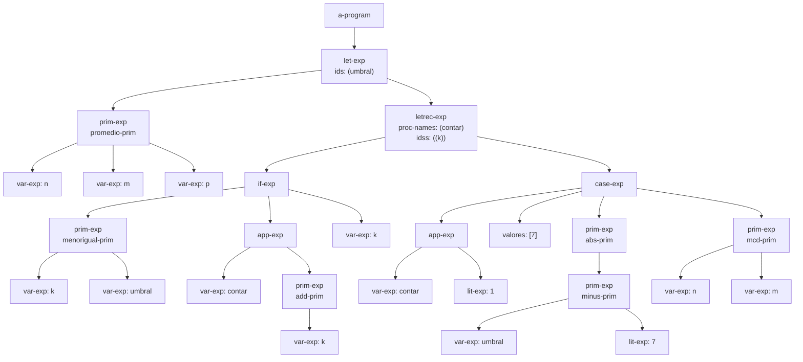
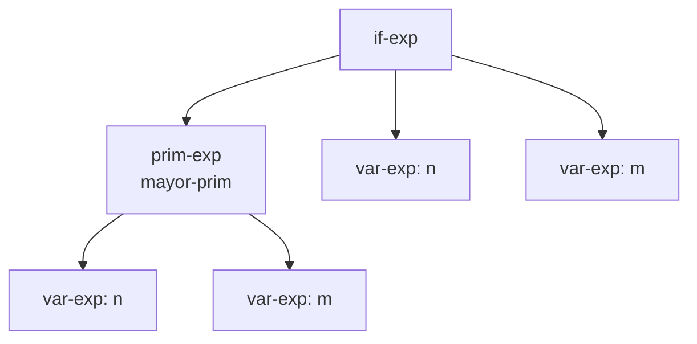
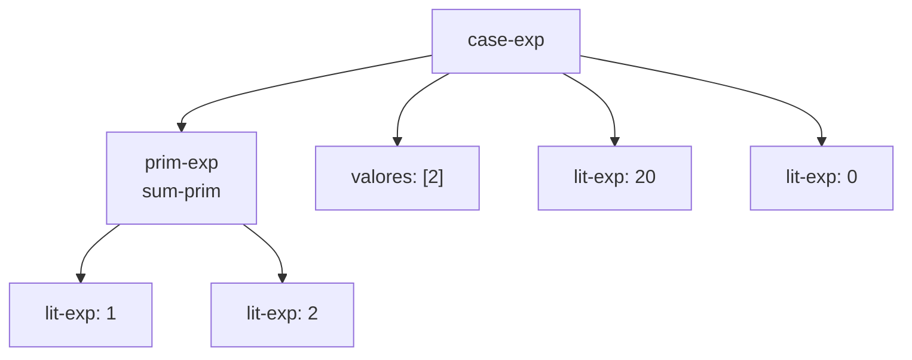
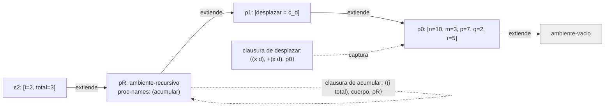

# Informe de AST — Taller 2: El intérprete de Cauca

> Informe de la Parte 5 (AST y traza) del Taller 2. Todos los diagramas son Mermaid y las fórmulas van en LaTeX.

**Curso:** Fundamentos de Interpretación y Compilación de Lenguajes de Programación — Universidad del Valle, Sede Tuluá.

**Integrantes del grupo:**

| Nombre | Código | Correo institucional |
|--------|--------|----------------------|
| Juan Felipe Aristizabal | 2459364-3743 | juan.felipe.aristizabal@correounivalle.edu.co |
| Juan Sebastian Huertas | 2459505-3743 | huertas.juan@correounivalle.edu.co |

---

## 1. Gramática considerada

La gramática está en `src/sintaxis.rkt`. SLLGEN genera a partir de ella los datatypes `programa`, `expresion` y `primitiva`.

```bnf
<programa>   ::= a-program(<expresion>)

<expresion>  ::= lit-exp(numero)
              ::= var-exp(identificador)
              ::= true-exp()
              ::= false-exp()
              ::= prim-exp(<primitiva>, {<expresion>}*)
              ::= if-exp(<expresion>, <expresion>, <expresion>)
              ::= let-exp({identificador}*, {<expresion>}*, <expresion>)
              ::= proc-exp({identificador}*, <expresion>)
              ::= app-exp(<expresion>, {<expresion>}*)
              ::= letrec-exp({identificador}*, {identificador}*, {<expresion>}*, <expresion>)              ::= case-exp(<expresion>, {numero}*, {<expresion>}*, <expresion>)

<primitiva>  ::= sum-prim | minus-prim | mult-prim | div-prim
              |  add-prim | sub-prim
              |  mayor-prim | mayorigual-prim | menor-prim | menorigual-prim | igual-prim
              |  not-prim | and-prim | or-prim
              |  abs-prim | mcd-prim | mcm-prim | promedio-prim
              |  xor-prim | implica-prim | entre-prim
```

Observación: en `case-exp` los valores de las ramas `of` son números crudos, no nodos `lit-exp`. Por eso en los diagramas aparecen como lista y no como hijos.

---

## 2. Ejemplos de AST

### Ejemplo 1 — Programa completo de la Parte 5.1

**Expresión concreta:**

```scheme
let umbral = promedio(n, m, p)
in
letrec
  contar (k) = if <=(k, umbral)
               then apply contar (add1(k))
               else k
               end
in
  case apply contar (1)
  of 7 => abs(-(umbral, 7))
  otherwise => mcd(n, m)
  end
end
end
```

**AST:**



**Explicación:** La raíz es `a-program`. Su expresión es un `let-exp` que liga `umbral` al resultado de `promedio-prim`, y su cuerpo es un `letrec-exp`. El `letrec` declara `contar` con parámetro `k` y cuerpo `if-exp`. En ese `if-exp`, la condición es `menorigual-prim` sobre `k` y `umbral`, la rama verdadera es una `app-exp` que llama a `contar` con `add-prim(k)`, y la rama falsa es `k`. El cuerpo del `letrec` es un `case-exp`: su control es `app-exp(contar, 1)`, la única rama `of` tiene el valor `7` con la acción `abs-prim(minus-prim(umbral, 7))`, y el `otherwise` es `mcd-prim(n, m)`. El `7` de la rama aparece como valor numérico dentro del nodo `case-exp`, no como `lit-exp`.

Valor del programa, calculado a partir de la semántica: $umbral = \frac{10+3+7}{3} = \frac{20}{3}$. `contar(1)` recorre $1, 2, \ldots$ mientras $k \le \frac{20}{3}$ y se detiene en $k = 7$, así que el control vale 7. La rama `of 7` se activa y devuelve $|\frac{20}{3} - 7| = \frac{1}{3}$.

---

### Ejemplo 2 — Condicional con primitiva relacional

**Expresión concreta:**

```scheme
if >(n, m) then n else m end
```

**AST:**



**Explicación:** El `if-exp` tiene tres hijos: la prueba, la rama verdadera y la rama falsa. La prueba es un `prim-exp` con `mayor-prim` y dos `var-exp`. Con el ambiente inicial $n = 10$ y $m = 3$, la prueba es verdadera y el valor es 10.

---

### Ejemplo 3 — `case` con una rama `of` y `otherwise`

**Expresión concreta:**

```scheme
case +(1, 2) of 2 => 20 otherwise => 0 end
```

**AST:**



**Explicación:** El control es la suma $1 + 2 = 3$. La lista de valores tiene un solo literal, $2$, que no coincide con 3, así que la evaluación cae en la rama `otherwise` y el resultado es 0. Las acciones `20` y `0` son `lit-exp`, pero el valor `2` de la rama `of` es un número crudo.

---

## 3. Traza de evaluación

**Expresión a evaluar:**

```scheme
let desplazar = proc (x, d) +(x, d) end
in
letrec
  acumular (i, total) = if >(i, m)
                        then total
                        else apply acumular
                             (add1(i), apply desplazar (total, i))
                        end
in
  apply acumular (1, q)
end
end
```

**Ambiente inicial:** $\rho_0 = [\,n = 10,\ m = 3,\ p = 7,\ q = 2,\ r = 5\,]\,\emptyset$.

Notación: $c_d = \langle (x, d),\ +(x,d),\ \rho_0 \rangle$ es la clausura de `desplazar`, y $\rho_R$ es el `ambiente-recursivo` del `letrec`. En ese momento $\rho_R$ guarda `acumular` y su cuerpo, y su ambiente externo es $\rho_1$.

**Pasos de la traza:**

1. $\text{value-of}(\texttt{proc}\ (x,d)\ +(x,d)\ \texttt{end},\ \rho_0) = c_d$. Como `let` evalúa las expresiones ligadas antes de extender el ambiente, la clausura cierra sobre $\rho_0$.
2. $\rho_1 = [\,desplazar = c_d\,]\rho_0$.
3. El `letrec` construye $\rho_R = \texttt{ambiente-recursivo}((acumular),\ ((i\ total)),\ (\text{cuerpo}),\ \rho_1)$ y evalúa `apply acumular (1, q)` en $\rho_R$.
4. $\text{value-of}(\texttt{acumular},\ \rho_R) = \langle (i, total),\ \text{cuerpo},\ \rho_R \rangle$. Como `acumular` no está en las ligaduras del `let`, la búsqueda llega a $\rho_R$ y arma la clausura allí.
5. $\text{value-of}(q,\ \rho_R) = 2$, porque la búsqueda va por $\rho_R \to \rho_1 \to \rho_0$.
6. Primera activación. $\varepsilon_1 = [\,i = 1,\ total = 2\,]\rho_R$. Evaluamos `if >(i, m)`: $\text{value-of}(m, \varepsilon_1) = 3$ y $1 > 3$ es falso, así que se toma la rama `else`.
7. En $\varepsilon_1$, `add1(i)` vale 2, y `apply desplazar (total, i)` evalúa `desplazar` en $\varepsilon_1 \to \rho_R \to \rho_1$, que da $c_d$. Los argumentos son $(2, 1)$ y el cuerpo `+(x,d)` se evalúa en $[\,x = 2,\ d = 1\,]\rho_0$, que da 3.
8. Primera llamada recursiva: `apply acumular (2, 3)` en $\varepsilon_1$.
9. Segunda activación. $\varepsilon_2 = [\,i = 2,\ total = 3\,]\rho_R$. $2 > 3$ es falso. `add1(2) = 3` y `desplazar(3, 2)` da 5.
10. **Segunda llamada recursiva**: `apply acumular (3, 5)` en $\varepsilon_2$. El diagrama de abajo corresponde a este momento.
11. Tercera activación. $\varepsilon_3 = [\,i = 3,\ total = 5\,]\rho_R$. $3 > 3$ es falso. `add1(3) = 4` y `desplazar(5, 3)` da 8.
12. Cuarta llamada: `apply acumular (4, 8)` en $\varepsilon_3$.
13. Cuarta activación. $\varepsilon_4 = [\,i = 4,\ total = 8\,]\rho_R$. $4 > 3$ es verdadero, así que se evalúa `total` en $\varepsilon_4$, que vale 8.

**Resultado final:** 8.

**Diagrama de la cadena de ambientes en la segunda llamada recursiva** (en $\varepsilon_2$):



**Explicación de la cadena:** En la segunda llamada recursiva, el ambiente de evaluación es $\varepsilon_2$, que extiende al `ambiente-recursivo` $\rho_R$. Ese ambiente extiende a $\rho_1$, donde está ligado `desplazar`, y $\rho_1$ extiende a $\rho_0$. La clausura de `desplazar` captura $\rho_0$, no $\rho_1$, porque se creó antes de extender el ambiente con `desplazar`. La clausura de `acumular` no se guarda en ningún ambiente: se arma cada vez que se busca el nombre, y cierra sobre $\rho_R$.

---

## 4. Estado del almacén en una transacción

No aplica. El lenguaje Cauca no tiene almacén, referencias ni bloques `atomic`.

---

## 5. Referencias

- Friedman, D. P., & Wand, M. *Essentials of Programming Languages*, 3.ª ed., MIT Press, 2008. Secciones 3.2 (el lenguaje LET), 3.3 (procedimientos y clausuras) y 3.4 (procedimientos recursivos, figura 3.9).
- Delgado, C. A. *Taller 2: El intérprete de Cauca*, enunciado, FLP 2026-II, Universidad del Valle.
- Notas de clase FLP, Clase 4 y Clase 6: https://cardel.github.io/notasUniversidad/2026-II/FLP/Contenido/