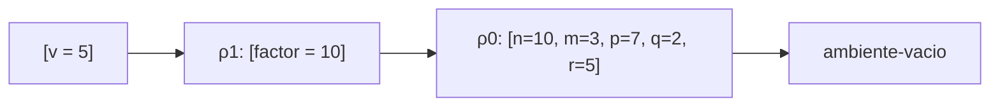
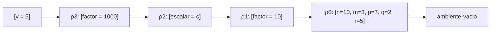
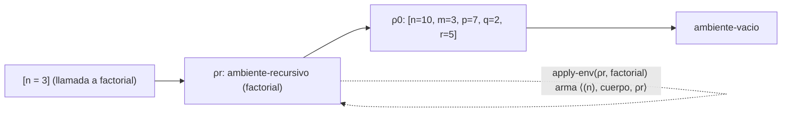

# Informe de corrección — Taller 2: El intérprete de Cauca

**Curso:** Fundamentos de Interpretación y Compilación de Lenguajes
de Programación — Universidad del Valle, Sede Tuluá.

**Integrantes del grupo:**

| Nombre | Código | Correo institucional |
|--------|--------|----------------------|
| Juan Felipe Aristizabal | 2459364-3743 | juan.felipe.aristizabal@correounivalle.edu.co |
| Juan Sebastian Huertas | 2459505-3743 | huertas.juan@correounivalle.edu.co |

---

## 1. Marco formal

### 1.1 Corrección de programas recursivos

Sea $f : A \to B$ una función y $A$ un conjunto definido
recursivamente. Sea $P_f$ un programa recursivo en Racket que
pretende calcular $f$. Decimos que $P_f$ es correcto con respecto a
su especificación si se cumple:

$$
\forall a \in A \,:\, P_f(a) = f(a)
$$

La estrategia de demostración es la **inducción estructural**
sobre $A$:

- **Caso base:** para cada valor básico $a_0 \in A$ se verifica
  $P_f(a_0) = f(a_0)$.
- **Caso inductivo:** asumiendo la **hipótesis de inducción**
  $P_f(a') = f(a')$ para las subestructuras $a'$ que forman $a$, se
  demuestra $P_f(a) = f(a)$.

### 1.2 Corrección de programas iterativos

Para un programa iterativo se formalizan:

- Un estado $s$ con componentes relevantes.
- Un estado inicial $s_0$.
- Un estado final reconocido por un predicado $\text{es-final?}(s)$.
- Una **invariante** $\text{Inv}(s)$ que se mantiene entre pasos.
- Una transformación $\text{transformar}(s)$.

La corrección se argumenta demostrando:

1. $\text{Inv}(s_0)$ se cumple al inicio.
2. $\text{Inv}(s) \,\land\, \lnot\text{es-final?}(s)\Rightarrow
   \text{Inv}(\text{transformar}(s))$.
3. $\text{Inv}(s) \,\land\, \text{es-final?}(s)\Rightarrow
   \text{respuesta}(s) = f(\text{entrada})$.
4. El proceso termina (argumentar una función de cota estrictamente
   decreciente sobre $\mathbb{N}$).

---

## 2. Funciones analizadas

Notación usada en todo el informe:

- $\rho$ denota un ambiente. $[x_1 = v_1, \ldots, x_k = v_k]\rho$ es el
  ambiente que extiende a $\rho$ con esas ligaduras
  (`ambiente-extendido`).
- $\rho_0$ es el ambiente inicial $[n=10, m=3, p=7, q=2, r=5]\emptyset$.
- $\text{value-of}(e, \rho)$ es el valor de la expresión $e$ en $\rho$,
  es decir, `(evaluar-expresion e ρ)`.
- $\langle ids, body, \rho \rangle$ es la clausura
  `(cerradura ids body ρ)`.

### 2.1 Corrección de `apply-procedure`

**Especificación.**

- **Tipo:** `apply-procedure : procval x lista de valores -> valor`
- **Pre-condición:**
  $\text{Pre}(proc, args) \equiv proc = \langle (x_1, \ldots, x_k), body, \rho_d \rangle
  \;\land\; args = (v_1, \ldots, v_m)$,
  donde $\rho_d$ es el ambiente vigente cuando se evaluó el `proc`
  que creó la clausura.
- **Post-condición:**

$$
\text{Post}(proc, args, r) \equiv
\begin{cases}
r = \text{value-of}\big(body,\ [x_1 = v_1, \ldots, x_k = v_k]\rho_d\big) & \text{si } k = m \\
\text{se levanta } \texttt{eopl:error} & \text{si } k \neq m
\end{cases}
$$

**Código.**

```racket
; proc-exp dentro de evaluar-expresion
(proc-exp (ids body)
  (cerradura ids body env))

; app-exp dentro de evaluar-expresion
(app-exp (rator rands)
  (let ((proc (evaluar-expresion rator env)))
    (if (procval? proc)
        (apply-procedure proc (evaluar-rands rands env))
        (eopl:error 'app-exp "~s no es un procedimiento" proc))))

; apply-procedure : procval x lista de valores -> valor
(define apply-procedure
  (lambda (proc args)
    (cases procval proc
      (cerradura (ids body env)
        (if (= (length ids) (length args))
            (evaluar-expresion body (ambiente-extendido ids args env))
            (eopl:error 'apply-procedure
                        "el procedimiento espera ~s argumento(s) y recibio ~s"
                        (length ids) (length args)))))))
```

**Estrategia de demostración:** `apply-procedure` no es recursiva, así
que la prueba es por casos sobre el `if`. Lo que hay que mostrar es de
dónde sale el ambiente en que se evalúa el cuerpo.

**Demostración.**

**(1) El ambiente de la clausura es el de la definición.** Por el
caso `proc-exp`:

$$
\text{value-of}(\texttt{proc}\ (x_1,\ldots,x_k)\ body\ \texttt{end},\ \rho)
= \langle (x_1,\ldots,x_k), body, \rho \rangle
$$

El cuerpo no se evalúa: se guarda junto con el $\rho$ actual. Por lo
tanto el tercer campo de toda clausura es el ambiente donde se definió,
$\rho_d$.

**(2) El cuerpo se evalúa en $\rho_d$ extendido, no en el ambiente de
la llamada.**

- **Caso $k = m$.** El `cases` desarma la clausura y liga
  `env` $= \rho_d$. Se ejecuta
  `(evaluar-expresion body (ambiente-extendido ids args env))`, es decir:

  $$
  r = \text{value-of}\big(body,\ [x_1 = v_1, \ldots, x_k = v_k]\rho_d\big)
  $$

  que es justo la post-condición.

- **Caso $k \neq m$.** La comparación `(= (length ids) (length args))`
  da `#f` y se levanta `eopl:error`, como pide la post-condición.

`apply-procedure` recibe solo `proc` y `args`; el ambiente de la
llamada ($\rho_c$, el `env` de `app-exp`) no se le pasa. Por eso no hay
forma de que el cuerpo se evalúe en $\rho_c$: el único ambiente que
tiene a mano es el que viene dentro de la clausura. $\rho_c$ solo se usa
en `app-exp` para evaluar el operador y los argumentos.

**Ejemplo de contraste (Parte 3).**

```
let factor = 10
in
  let escalar = proc (v) *(v, factor) end
  in
    let factor = 1000
    in
      apply escalar (5)
    end
  end
end
```

Los ambientes que se van formando:

$$
\begin{aligned}
\rho_1 &= [factor = 10]\rho_0 \\
c &= \langle (v),\ *(v, factor),\ \rho_1 \rangle \\
\rho_2 &= [escalar = c]\rho_1 \\
\rho_3 &= [factor = 1000]\rho_2 \qquad \text{(ambiente de la llamada)}
\end{aligned}
$$

*Con clausuras (lo implementado):* el cuerpo se evalúa en
$[v = 5]\rho_1$. Al buscar `factor` se recorre
$[v=5] \to \rho_1$ y se encuentra $factor = 10$:

$$
\text{value-of}(*(v, factor),\ [v=5]\rho_1) = 5 \cdot 10 = 50
$$



*Si se usara el ambiente de la llamada (alcance dinámico):* el cuerpo se
evaluaría en $[v = 5]\rho_3$, y la primera ligadura de `factor` que se
encuentra es la de $\rho_3$:

$$
\text{value-of}(*(v, factor),\ [v=5]\rho_3) = 5 \cdot 1000 = 5000
$$



El intérprete devuelve 50 (prueba *"el cuerpo se evalua en el ambiente
de la definicion"* de `pruebas-cauca.rkt`), lo que confirma que se usa
la primera cadena.

**(3) La aplicación falla exactamente en los dos casos de error.**
Sea $v_r = \text{value-of}(rator, \rho_c)$. Juntando `app-exp` y
`apply-procedure`:

$$
\text{la aplicación levanta error} \iff \lnot\,\text{procval?}(v_r)
\;\lor\; \big(\text{procval?}(v_r) \land k \neq m\big)
$$

- ($\Leftarrow$) Si $v_r$ no es procedimiento, el `if` de `app-exp`
  toma la rama del `eopl:error`. Si sí lo es pero $k \neq m$, se llega
  al `eopl:error` de `apply-procedure`.
- ($\Rightarrow$) Las únicas dos llamadas a `eopl:error` en ese camino
  son esas. Si $v_r$ es procedimiento y $k = m$, ninguna se ejecuta y
  se evalúa el cuerpo. Un error que salga *dentro* del cuerpo o de los
  argumentos (por ejemplo, una variable libre) viene de esa evaluación y
  no de la aplicación.

Los dos casos están cubiertos en las pruebas:
`apply 5 (1)` da `app-exp: 5 no es un procedimiento`, y
`let f = proc (a, b) +(a, b) end in apply f (1) end` da
`apply-procedure: el procedimiento espera 2 argumento(s) y recibio 1`.

- **Terminación.** `apply-procedure` hace un número fijo de pasos antes
  de evaluar el cuerpo, así que termina siempre que termine la
  evaluación del cuerpo. Que el cuerpo termine depende del programa
  (ver 2.2 para el caso recursivo).

**Conclusión:** para toda clausura y toda lista de argumentos que
cumplan la pre-condición, `apply-procedure` cumple la post-condición, y
el cuerpo se evalúa en el ambiente de la definición.

---

### 2.2 Corrección de la ligadura recursiva (`letrec`)

**Especificación.**

- **Tipo:** `apply-env : ambiente x symbol -> valor`, en el caso
  `ambiente-recursivo`.
- **Pre-condición:** el `letrec` declara $f_1, \ldots, f_k$ con
  parámetros $\vec{x}_1, \ldots, \vec{x}_k$ y cuerpos
  $b_1, \ldots, b_k$, y se evalúa en $\rho$. Sea

  $$
  \rho_r = \texttt{ambiente-recursivo}\big((f_1..f_k),\ (\vec{x}_1..\vec{x}_k),\ (b_1..b_k),\ \rho\big)
  $$

- **Post-condición:**

$$
\text{apply-env}(\rho_r, y) =
\begin{cases}
\langle \vec{x}_j, b_j, \rho_r \rangle & \text{si } y = f_j \text{ (primera aparición)} \\
\text{apply-env}(\rho, y) & \text{si } y \notin \{f_1, \ldots, f_k\}
\end{cases}
$$

**Código.**

```racket
; letrec-exp dentro de evaluar-expresion
(letrec-exp (proc-names idss bodies letrec-body)
  (evaluar-expresion letrec-body
                     (ambiente-recursivo proc-names idss bodies env)))

; caso ambiente-recursivo dentro de apply-env
(ambiente-recursivo (proc-names idss bodies env-externo)
  (let ((pos (posicion id proc-names 0)))
    (if pos
        (cerradura (list-ref idss pos) (list-ref bodies pos) env)
        (apply-env env-externo id))))
```

Aquí `env` es el parámetro de `apply-env`, es decir, el propio
$\rho_r$, mientras que `env-externo` es el $\rho$ que se guardó dentro.

**(1) Invariante.** Para todo $i$, el ambiente en que se evalúa el
cuerpo $b_i$ en una llamada a $f_i$ es
$[\vec{x}_i = \vec{v}]\rho_r$, y en ese ambiente

$$
\text{Inv}:\quad \forall j \in \{1..k\},\ f_j \notin \vec{x}_i \;\Rightarrow\;
\text{apply-env}\big([\vec{x}_i = \vec{v}]\rho_r,\ f_j\big) = \langle \vec{x}_j, b_j, \rho_r \rangle
$$

En palabras: dentro del cuerpo de cualquier procedimiento del `letrec`
están visibles todos los procedimientos del mismo `letrec`, incluido
él mismo, y sus clausuras vuelven a cerrar sobre $\rho_r$. La condición
$f_j \notin \vec{x}_i$ solo excluye el caso en que un parámetro oculte
el nombre, que es el shadowing normal.

**(2) `apply-env` sobre `ambiente-recursivo` cumple el invariante.**

*Lema (`posicion`).* `(posicion id ids 0)` devuelve el índice de la
primera aparición de `id` en `ids`, o `#f` si no aparece. Por inducción
sobre `ids`:

- Base, `ids` $= ()$: devuelve `#f`, y en efecto `id` no aparece.
- Paso, `ids` $= (a\ .\ resto)$: si `id` $= a$, devuelve el índice
  actual $i$, que es la primera aparición. Si no, devuelve
  `(posicion id resto (+ i 1))`, que por hipótesis de inducción es el
  índice correcto dentro de `resto` corrido en uno, o `#f`.

*Demostración de la post-condición.*

- Si $y = f_j$: por el lema, `pos` $= j$ y se devuelve
  `(cerradura (list-ref idss j) (list-ref bodies j) env)` con
  `env` $= \rho_r$. Queda $\langle \vec{x}_j, b_j, \rho_r \rangle$.
- Si $y \notin \{f_1..f_k\}$: `pos` $=$ `#f` y se delega a
  `(apply-env env-externo y)` $= \text{apply-env}(\rho, y)$.

*Demostración del invariante.* Al aplicar $\langle \vec{x}_i, b_i, \rho_r \rangle$,
por 2.1 el cuerpo se evalúa en $[\vec{x}_i = \vec{v}]\rho_r$. Si
$f_j \notin \vec{x}_i$, la búsqueda de $f_j$ no la encuentra en la
extensión y pasa a $\rho_r$, donde por la post-condición se obtiene
$\langle \vec{x}_j, b_j, \rho_r \rangle$. Esa clausura cierra otra vez
sobre $\rho_r$, así que la siguiente llamada se evalúa en otro
$[\ldots]\rho_r$ y el invariante se mantiene a cualquier profundidad de
recursión (inducción sobre el número de llamadas anidadas).

La clausura no se guarda en el ambiente: se arma cada vez que se busca
el nombre. Por eso no hace falta una estructura circular: $\rho_r$
existe antes de que exista cualquier clausura, y cada clausura apunta a
$\rho_r$.



**(3) Por qué `let` no basta.** La misma declaración con `let`:

```
let fact = proc (k) if ==(k, 0) then 1 else *(k, apply fact (sub1(k))) end end
in apply fact (3) end
```

`let-exp` evalúa los `rands` en el ambiente actual $\rho$ **antes** de
extenderlo. Por 2.1 (1), el `proc` se evalúa en $\rho$ y se obtiene
$\langle (k), b, \rho \rangle$, con $fact \notin \text{dom}(\rho)$. Al
aplicarlo, el cuerpo se evalúa en $[k = 3]\rho$, donde `fact` no está.
La búsqueda llega a `ambiente-vacio` y el intérprete responde:

```
apply-env: la variable fact no esta ligada
```

O sea que con `let` el invariante falla: el ambiente del cuerpo no
contiene el nombre del procedimiento. Si $\rho$ tuviera otra ligadura
de `fact` más afuera, sería peor: no habría error y se llamaría a ese
otro `fact` sin que nadie se diera cuenta.

**(4) Terminación de `potencia`.**

```
letrec
  potencia (base, exp) = if ==(exp, 0)
                         then 1
                         else *(base, apply potencia (base, sub1(exp)))
                         end
in
  apply potencia (2, 10)
end
```

Pre-condición: $exp \in \mathbb{N}$. La medida es $\mu(base, exp) = exp$.

- Si $exp = 0$ se toma la rama `then` y se devuelve 1 sin llamada
  recursiva.
- Si $exp > 0$ la única llamada recursiva es con $exp - 1$, y
  $0 \le exp - 1 < exp$.

$\mu$ decrece estrictamente en cada llamada y está acotada inferiormente
por 0 en $\mathbb{N}$, así que después de exactamente $exp$ llamadas se
llega al caso base. Para `apply potencia (2, 10)` son 10 llamadas
recursivas.

De paso, el resultado es correcto por inducción sobre $exp$:
$\text{potencia}(b, 0) = 1 = b^0$, y si
$\text{potencia}(b, exp - 1) = b^{exp-1}$ entonces
$\text{potencia}(b, exp) = b \cdot b^{exp-1} = b^{exp}$. Para el
ejemplo, $2^{10} = 1024$, que es lo que da el intérprete.

Con $exp < 0$ (fuera de la pre-condición) el `if` nunca llega a
$exp = 0$ y la recursión no termina.

**Conclusión:** `apply-env` sobre un `ambiente-recursivo` devuelve
clausuras que cierran sobre el mismo $\rho_r$, y con eso todo
procedimiento declarado en un `letrec` puede llamarse a sí mismo y a
los demás del mismo `letrec`.

---

### 2.3 Corrección de `case-exp`

**Especificación.**

- **Tipo:** `case-exp` se resuelve en `evaluar-expresion` y delega en el auxiliar `seleccionar-caso : número x lista de números x lista de expresiones x expresión x ambiente -> valor`.
- **Pre-condición:** la expresión de control $e$ es una expresión válida; $vs = (v_1, \ldots, v_k)$ y $as = (a_1, \ldots, a_k)$ tienen la misma longitud $k \geq 0$, porque el parser genera un valor y una acción por cada `of`; $d$ es la expresión de `otherwise`; y $\rho$ es un ambiente.
- **Post-condición:** sea $c = \text{value-of}(e, \rho)$. Entonces

$$
\text{Post}(e, \rho, r) \equiv
\begin{cases}
\texttt{eopl:error} & \text{si } c \text{ no es un número} \\
r = \text{value-of}(a_j, \rho), \ \text{con } j = \min\{\, i : v_i = c \,\} & \text{si } c \text{ es número y existe tal } j \\
r = \text{value-of}(d, \rho) & \text{si } c \text{ es número y ningún } v_i = c
\end{cases}
$$

Además, $e$ se evalúa exactamente una vez.

**Código.**

```racket
; case-exp dentro de evaluar-expresion
(case-exp (exp valores acciones default)
  (let ((control (evaluar-expresion exp env)))
    (if (number? control)
        (seleccionar-caso control valores acciones default env)
        (eopl:error 'case "el control debe ser numero y llego ~s" control))))

; seleccionar-caso : número x lista de números x lista de expresiones x expresión x ambiente -> valor
(define seleccionar-caso
  (lambda (control valores acciones default env)
    (cond ((null? valores) (evaluar-expresion default env))
          ((= control (car valores)) (evaluar-expresion (car acciones) env))
          (else (seleccionar-caso control (cdr valores) (cdr acciones) default env)))))
```

**Estrategia de demostración:** inducción estructural sobre la lista de ramas $vs$ para `seleccionar-caso`, y un argumento directo sobre la cláusula `case-exp` para la evaluación única y el error.

**Demostración.**

**(1) Lema: selección de la rama, por inducción sobre $k$.** Sea $S(k)$: para toda lista de $k$ ramas, todo número $c$ y todo ambiente $\rho$, `(seleccionar-caso c vs as d ρ)` cumple la parte de la post-condición que corresponde a $c$ número.

- **Caso base, $k = 0$.** $vs = ()$, así que no hay ramas. La función llama a `(evaluar-expresion d ρ)`, que es el valor de `otherwise`, como pide la post-condición.
- **Caso inductivo, $k > 0$.** Sea $vs = (v_1 \,.\, resto_v)$ y $as = (a_1 \,.\, resto_a)$. Hay dos subcasos según la prueba `=`:
  - Si $c = v_1$, la función evalúa $a_1$ y devuelve $\text{value-of}(a_1, \rho)$. Como $v_1$ es el primer elemento, $j = 1$ es el mínimo, y la post-condición se cumple.
  - Si $c \neq v_1$, la función llama a `seleccionar-caso` con las colas $resto_v$, $resto_a$, el mismo $c$, $d$ y $\rho$. La longitud de las colas es $k - 1$, así que por hipótesis de inducción devuelve la rama del primer índice $i \geq 2$ con $v_i = c$, o $\text{value-of}(d, \rho)$ si no existe. Como $v_1 \neq c$, ese índice es también el mínimo de la lista completa, y la post-condición se cumple.

Con esto, para toda lista de ramas y todo $c$ numérico, la función devuelve la acción de la primera coincidencia, o la de `otherwise` si no hay coincidencia.

**(2) Evaluación única de la expresión de control.** La expresión $e$ aparece en la cláusula `case-exp` en una sola llamada, `(evaluar-expresion exp env)`, que liga el resultado a `control`. Después, `seleccionar-caso` recibe el valor $c$ y no la expresión $e$: su cuerpo no contiene `exp`, y sus llamadas a `evaluar-expresion` son solo sobre $a_i$ o $d$. Por tanto, las llamadas recursivas de la sección (1) nunca vuelven a evaluar $e$, sin importar cuántas ramas tenga. La cuenta de evaluaciones de $e$ es 1 para todo $k \geq 0$.

Conviene aclarar que el lenguaje no tiene efectos secundarios, así que la unicidad no se ve en el resultado de un programa; se demuestra por la forma del código, que es la propiedad que pide el enunciado.

**(3) Error cuando el control no es numérico.** La condición `(number? control)` se evalúa antes de tocar ninguna rama. Si $c$ no es número, se ejecuta `eopl:error` y ninguna $a_i$ ni $d$ se evalúa. Esto cubre el caso del `if`-like `case true of ...`, que es el caso de error de las pruebas.

Nota sobre el error: si la evaluación de $e$ misma falla (por ejemplo, una variable no ligada), el error viene de esa evaluación y no de `case`. La post-condición se refiere al caso en que $e$ termina con un valor que no es número.

**(4) Terminación.** Hay dos recorridos:

- `seleccionar-caso` usa como medida $\mu(vs) = \text{longitud}(vs)$. En cada llamada recursiva la lista es `(cdr valores)`, así que $\mu$ decrece en 1. Como $\mu \geq 0$, después de como máximo $k$ llamadas se llega a `(null? valores)`, que es el caso base.
- `evaluar-expresion` sobre $e$, $a_i$ o $d$ termina porque cada uno es un subárbol estrictamente más pequeño del nodo `case-exp`, y el AST es finito. El recorrido sobre las ramas no vuelve a entrar en el mismo nodo.

**Ejemplos que cubren la especificación** (en `pruebas-cauca.rkt`, sección de Parte 4):

- `let dia = 3 in case dia of 1 => 100 of 3 => 300 of 7 => 700 otherwise => 0 end end` da 300: la primera coincidencia es la rama `of 3`.
- `let dia = 5 in case dia of 1 => 100 of 3 => 300 otherwise => 0 end end` da 0: ninguna rama coincide y se evalúa `otherwise`.
- `case +(1, 2) of 2 => 20 of 3 => 30 otherwise => 0 end` da 30: el control se calcula una vez y vale 3.
- `case true of 1 => 1 otherwise => 0 end` levanta error: el control no es número.

**Conclusión:** `case-exp` cumple la especificación. Selecciona la acción de la primera rama cuyo literal coincide con el control, evalúa `otherwise` cuando ninguna coincide, evalúa el control una sola vez, levanta error cuando el control no es numérico, y el recorrido sobre las ramas termina porque su longitud decrece en cada paso.

---

## 3. Propiedades adicionales (si aplica)

### 3.1 Shadowing en `apply-env`

**Propiedad.** Para todo ambiente $\rho$, identificador $x$ y valor $v$:

$$
\text{apply-env}([x = v]\rho,\ x) = v
\qquad
\text{apply-env}([x = v]\rho,\ y) = \text{apply-env}(\rho,\ y)\ \text{ si } y \neq x
$$

Más en general, si $x$ aparece en los `ids` de una extensión, se
devuelve el valor de la **primera** aparición y nunca se mira el
ambiente externo.

**Demostración.** En el caso `ambiente-extendido` de `apply-env`, por el
lema de `posicion` (sección 2.2), `pos` es el índice de la primera
aparición de `x` en `ids`, y se devuelve `(list-ref valores pos)` sin
llamar a `apply-env` sobre `env-externo`. Solo si `pos` es `#f` se
busca afuera. Como cada `let` o aplicación agrega una extensión nueva
**encima** de la anterior, la ligadura más reciente es la primera que
se encuentra.

**Terminación.** Cada llamada recursiva de `apply-env` es sobre el
ambiente externo, que es una subestructura estricta. La cadena es
finita y termina en `ambiente-vacio`, donde se levanta `eopl:error`.
Así, buscar una variable no ligada da error en lugar de quedarse en un
ciclo. En el caso `ambiente-recursivo` también se pasa a `env-externo`,
porque la clausura se arma sin volver a buscar.

Ejemplo verificado: `let x = 1 in let x = 2 in x end end` da 2.

---

## 4. Referencias

- Friedman, D. P., & Wand, M. *Essentials of Programming Languages*,
  3.ª ed., MIT Press, 2008. Secciones 3.2 (ambientes), 3.3
  (procedimientos y clausuras) y 3.4 (`letrec`, figura 3.9).
- Delgado, C. A. *Taller 2: El intérprete de Cauca*, enunciado, FLP
  2026-II, Universidad del Valle.
